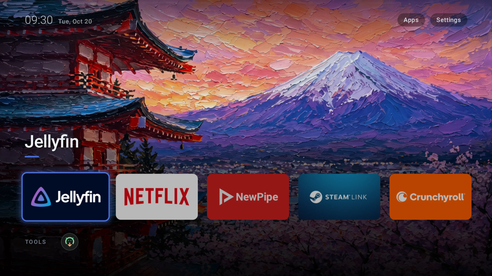
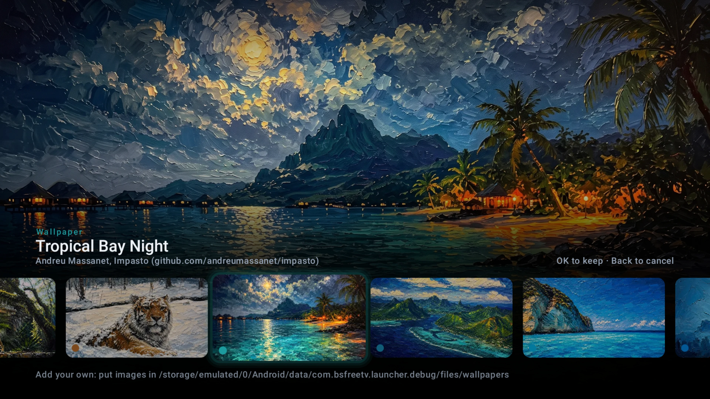
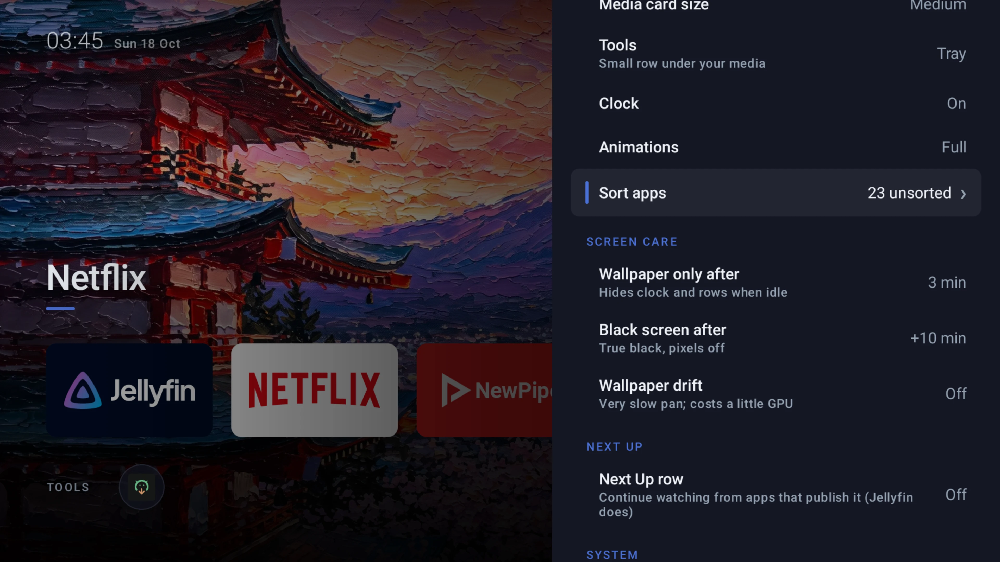
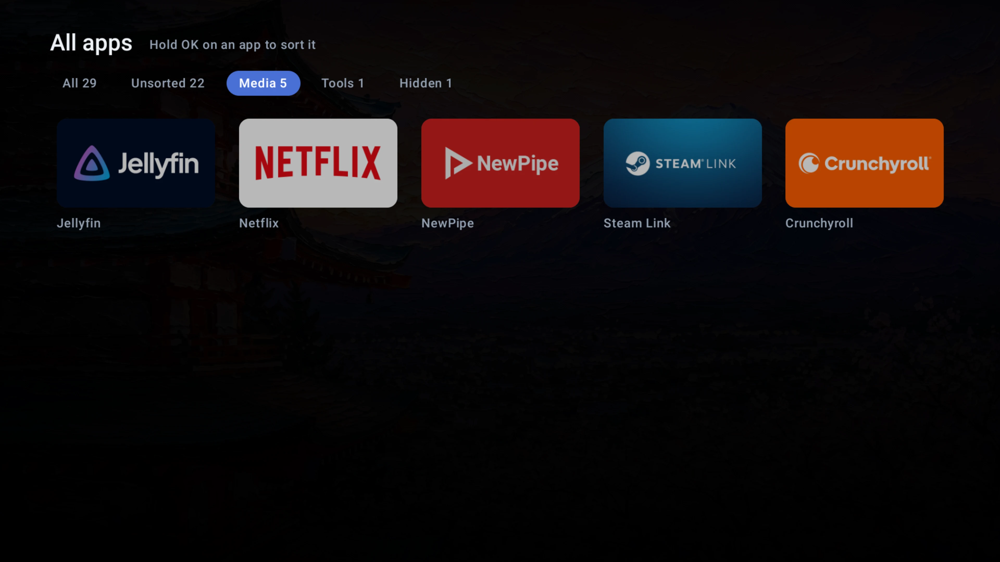
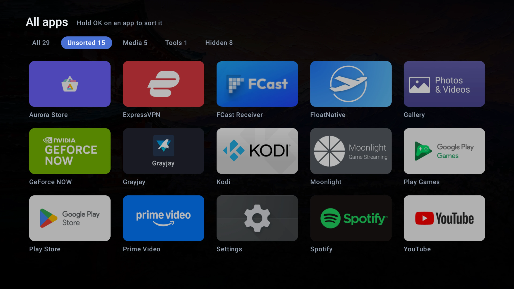

# BSfreeTV

An ad-free launcher for Android TV and Google TV. Built and tuned on the
NVIDIA SHIELD TV Pro, made to run on any TV box with Android 11 or newer.

[](https://github.com/xblackbytesx/bsfreetv/actions/workflows/ci.yml)
[](https://github.com/xblackbytesx/bsfreetv/actions/workflows/release.yml)
[](https://github.com/xblackbytesx/bsfreetv/releases/latest)
[](LICENSE)
[](#install)

- Your media apps up front as large banners; tools in a small tray (or hidden).
- 40 built-in paintings from [Impasto](https://github.com/andreumassanet/impasto);
  the accent colour follows the wallpaper.
- OLED care: true black, wallpaper-only after a few idle minutes, then black,
  slow pixel shift on everything static.
- Optional Next Up row from apps that publish Watch Next (Jellyfin does).
- Makes itself the Home app from its own settings (self-ADB), with one-click undo.

## Screenshots



<table>
  <tr>
    <td width="50%"><br><sub>Wallpaper picker: focus previews full screen, the accent follows</sub></td>
    <td width="50%"><br><sub>Settings: only what changes something, including screen care</sub></td>
  </tr>
  <tr>
    <td width="50%"><br><sub>All apps, Media: what the home row shows</sub></td>
    <td width="50%"><br><sub>All apps, Unsorted: hold OK on an app to sort it</sub></td>
  </tr>
</table>

## Devices

| Device | Status |
|---|---|
| NVIDIA SHIELD TV / TV Pro (2019) | Tested daily. Everything, including the in-app Home switch |
| Other classic Android TV, Android 11+ | Should work, not yet tested. If the in-app Home switch can't connect, use the PC commands below |
| Google TV (Chromecast with Google TV, Google TV Streamer, Google TV TVs) | Runs as an app. **The Home switch is not supported** and is disabled in the app |
| Android 10 and older | Not supported |

Tested it on another box? Open an issue with the device and what worked.

## Install

```
make build
adb connect <shield-ip>:5555
adb install -r build-output/bsfreetv-debug.apk
```

Open BSfreeTV from the app list, then **Settings > Default launcher**.

## Make it the Home app

> [!WARNING]
> **Classic Android TV only (such as the NVIDIA Shield). Never on Google TV.**
> Google TV opens its own launcher directly when you press Home. Disabling it
> makes the device restart in a loop. Version 0.2.0 did this on Google TV;
> 0.2.1 and later refuse. If your Google TV is affected, see Recovery below.

1. Shield: Settings > Device Preferences > About, press Build 7 times.
2. Developer options: turn on **Network debugging**.
3. BSfreeTV: Settings > Default launcher > **Test connection**, choose Allow
   (tick Always allow) on the prompt, then **Make BSfreeTV Home**.
4. Turn Network debugging off again.

From a PC instead:

```
adb shell pm disable-user --user 0 com.google.android.tvlauncher
adb shell pm grant com.bsfreetv.launcher android.permission.READ_TV_LISTINGS
```

### Recovery

Undo, and the recovery if Home ever stops working. This covers both classic
Android TV and Google TV:

```
adb shell pm enable com.google.android.tvlauncher
adb shell pm enable com.google.android.apps.tv.launcherx
adb shell cmd package set-home-activity com.google.android.apps.tv.launcherx
```

On a Shield the last two lines report an unknown package; that is harmless.
These commands need a working adb connection. A device already stuck in a
reboot loop may need a factory reset from its recovery menu.

Restore the stock launcher before uninstalling BSfreeTV.

## Using it

- Hold OK (or Menu) on any app: Add to Media, Move to Tools, Reorder, Hide.
- Reorder: Left/Right moves the app, OK finishes.
- Your own wallpapers: put images in
  `/sdcard/Android/data/com.bsfreetv.launcher/files/wallpapers/`
  (`adb push`), or use Add image when the device has a file picker.

## Translations

The interface is currently available in English, Dutch, German, Spanish,
French, Italian, Portuguese, Polish, Ukrainian, Arabic, Japanese, Korean and
Simplified Chinese. BSfreeTV uses your TV's language automatically; to choose
a different one, go to **Settings > Language**.

Translations are welcome on
[Hosted Weblate](https://hosted.weblate.org/projects/bsfreetv/). No coding
needed, and Weblate opens the pull request for you.

## License

Copyright (C) 2026 xblackbytesx. BSfreeTV is free software, released under the
[GNU General Public License v3.0](LICENSE): use it, change it, share it. If you
distribute a modified version, your users get the same source and the same
freedoms you did.

The built-in wallpapers are by Andreu Massanet, from
[Impasto](https://github.com/andreumassanet/impasto), also GPL-3.0. See
[CREDITS.md](CREDITS.md).
